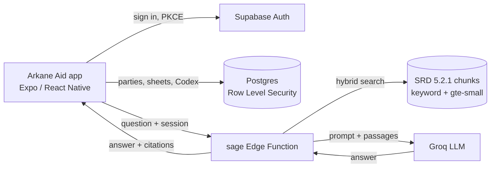

## Presentation Video

Presentation Video: [link coming]

## Demo Video (5-8 min)

Demo video: [link coming]

<h1 align="center">Arkane Aid</h1>

<p align="center"></p>

<p align="center"><strong>A spoken companion for a live Dungeons and Dragons table.</strong></p>

Arkane Aid keeps the game moving. Ask a rule and hear the answer. Say what just happened and it lands in the session notes. Keep a character sheet that travels with your party, and roll your dice on the phone. The dungeon master still has the final say.

Built with Expo (React Native, TypeScript), Supabase and Groq. Android first.

My final year project for Interactive Development (4th year).

---

## 1. Overview

### Problem

A live table stalls every time someone has to look up a rule, write down what happened, or dig for a number on a character sheet. Rulebooks are slow at the table. Most digital tools are built for the dungeon master, not for the player who is already holding dice.

### Solution

Arkane Aid is a player-side companion.

The Sage answers a ruling in a few short spoken sentences, grounded in the 2024 rules covered by the official SRD 5.2.1. The Scribe turns what the table just said into a note in the Codex. The Player Sheet holds your character for the current party and saves itself as you type. The dice roller throws 3D dice from the Home screen. None of it replaces the dungeon master.

### Target users

Players at a small live table who want a quick ruling, a note, a number or a roll without stopping the game.

### Platform

Android first. The app is built with EAS as an APK. A development build is used while working on the code. Voice input, the 3D dice and shake to roll need a native build, so they do not work in Expo Go.

---

## 2. Features

### Authentication

Email sign up and login through Supabase Auth. The app never handles password hashing itself and never writes passwords to the device. Only the session tokens are kept on the phone. Sign up asks for the password twice, and both screens require at least 8 characters. Error messages never reveal whether an email is already registered. A profile row is created on first sign in. Sign out is in the Tome.

Google sign-in opens Google in the browser through Supabase (expo-web-browser) and comes back to the app signed in. If the Google provider is not switched on in Supabase, the button says so. The Facebook button only shows a notice for now.

Sign-in links use PKCE: the link carries a one-time code that only the phone that asked for it can swap for a session.

### Password reset

"Forgot password?" on the Login screen sends a reset email through Supabase's built-in mailer. Open the email on the same phone and tap the link. It opens the app on the reset screen (`arkaneaid://reset-password`), where you set a new password twice and are signed straight in. A link that has expired or was opened on another device says so and asks for a new one. No custom SMTP is needed.

### Parties

Create a party and get a 6-character join code, or join one with a code. The creator is the dungeon master and everyone who joins is a player. Switch the active party in the Tome. Notes and the character sheet are scoped to the selected party, so one campaign never leaks into another.

### Home

The dashboard has a dial of seals for the Sage and Scribe, the Codex and the Tome. Swipe to turn the dial, or tap a seal to open it. The d20 in the middle opens the dice roller. The tab bar at the bottom has Home, Codex, Sage and Tome.

### Dice roller

Tap the d20 on Home. The **Check** tab uses your Player Sheet and Codex to calculate common skill checks, saving throws, ability checks, attacks and damage. It includes advantage/disadvantage and Guidance or Bless where applicable; you can set a DC or AC when needed. Use **Free roll** to choose a die (d4, d6, d8, d10, d12 or d20), how many (up to 40) and a bonus, then tap Roll or shake the phone. Free Roll totals the dice and bonus but does not calculate character bonuses or determine success. The dice are 3D and land on the number they rolled. The tray shows up to 10 dice but the total counts all of them. A natural 20 turns gold and glows, a natural 1 turns red with a red flash, and each has its own buzz. The pop-up uses the same ink and paper look as the Player Sheet.

### Sage

Ask a ruling by typing it or by holding the orb and speaking. The answer comes back in short sentences, writes itself out on a parchment card and is read aloud by the phone's own text to speech.

When a question is about you ("can I", "my spells", "what am I holding"), your Character Sheet goes along with it: your weapons (the one in hand marked), spells, and the newest notes and items in the party's Codex. A general rules question goes without it and costs fewer tokens. "Check my sheet" runs a fixed rules check on the sheet, and the Sage explains what it found. Questions about what the party can do read the sheets of everyone in your party.

A homebrew species is taken as written. The Sage still helps, using the closest official 2024 species and your class as a guide.

The Sage has three voices, picked in the Tome:

| Voice | Style | Orb |
|-------|-------|-----|
| Wizard | The Sage as an old court mage | Red |
| Arbiter | Short, sure rulings from the bench | Blue |
| Bard | Rulings with a rhyme and a wink | Green |

All three share the same rules, scope and limits and only differ in tone. Each has its own speech rate and pitch, so they sound different too.

The Sage keeps the last three exchanges of the current session, so a follow-up like "how long does it last?" works. That memory is cleared when you leave the screen, switch mode or change voice, and it is never saved.

### Voice input

Pick Sage or Scribe, hold the orb to talk and let go to send. It uses the phone's own speech recogniser, so there is no extra key or paid service. It listens in South African English and falls back to US English on phones without that language pack. A short list of game words (cantrip, saving throw, spell slot and so on) is passed to the recogniser so they are heard correctly.

### Rules and sources

The Sage answers rules questions using the 2024 rules covered by the System Reference Document 5.2.1, bundled with the `sage` Edge Function. The SRD is the rules source available to the app; it is not the full set of 2024 rulebooks, and the app does not automatically apply every rule or situation during play. Search is hybrid: keyword search that forgives typos ("firebal", "grapled"), plus meaning search using Supabase's built-in `gte-small` embeddings, so a plain question like "can I hit someone running away" still finds Opportunity Attacks. If the embeddings table is empty, it falls back to keyword search alone.

Answers taken from the SRD show a small "Source:" line under the reply, such as "Fireball, p. 131". That line is never read aloud. When the SRD has nothing on a question, the Sage says it is not sure and that the dungeon master decides. Lore and campaign questions get a short answer labelled "Lore:" or "Homebrew idea:", so an invented idea is never passed off as an official rule. Questions that have nothing to do with D&D get a short in-character refusal and a nudge back to the game.

### Scribe

Pick Scribe on the Sage screen, say or type what just happened, and the Scribe writes it as a single past-tense line in the Codex for the current party. No advice, no rulings.

### Codex

The session book, with All, Notes, Items, Weapons, Spells and Sheet tabs. The tab row scrolls sideways on narrow phones and fades at the edges. Add a note or an item, tap your own note to edit it, or press and hold your own note or item to delete it. Only the current party's entries show.

Weapons and Spells are your own, per party. Pick from the SRD list or write your own. Exactly one weapon is in hand; it sits at the top and the Sage uses it. The to-hit box suggests STR (DEX for ranged weapons, the higher of the two for Finesse) plus your Proficiency Bonus. Type a number and it gets its "+" when you leave the box. Spells are grouped by level in tabs, Cantrip to 9th. Open a weapon or spell to edit it or delete it. The Sheet tab opens the Character Sheet.

### Player Sheet

Name, species, lineage, class, subclass, level, hit points, armour class, speed, the six abilities, skills, languages, features, background, traits, equipment and a portrait from the gallery. Species and class pick from the official 2024 lists (SRD 5.2.1), with a custom option; a custom species gets a Homebrew box for its traits, which the Sage treats as your table's homebrew.

Numbers go in number boxes you can type in freely. Level runs from 1 to 20 and hit points go up to 999. The Proficiency Bonus follows the level. The sheet saves itself 0.8 s after you stop typing, and when you leave, switch tab or party, or put the app away. A blank sheet is never saved. One sheet per person per party.

### Tome (settings)

Shows which party you are in. Account options cover sign out, creating or joining a party, switching the active party and reloading. Guidance has the how-to tips, which also pop up once (with a Got it button) the first time each account opens the app on a phone. Voice Personality picks Wizard, Arbiter or Bard, and a toggle turns spoken replies on or off. Both choices are saved on the device.

---

## 3. Tech stack

| Layer | Technology |
|-------|------------|
| Framework | Expo SDK 58 with expo-dev-client (React Native 0.88, React 19.3) |
| Language | TypeScript |
| Auth and data | Supabase Auth (PKCE, email and Google), Postgres, Storage, Row Level Security |
| Sign-in browser | expo-web-browser |
| Rules search | SRD 5.2.1 chunks, pgvector, Supabase `gte-small` embeddings |
| AI | Groq (`gpt-oss-120b` for the Sage, `gpt-oss-20b` for the Scribe and as a fallback), called only from a Supabase Edge Function |
| Speech out | expo-speech |
| Speech in | expo-speech-recognition |
| 3D | three, @react-three/fiber and expo-gl (the Sage orb and the dice) |
| Shake and buzz | expo-sensors, expo-haptics |
| Images | expo-image, expo-image-picker |
| Fonts | Cinzel Decorative, Asul, MedievalSharp, Atkinson Hyperlegible |
| Builds | EAS Build |

The Groq key only lives as a Supabase function secret. It is never in the app, the APK or this repository.

---

## 4. Installation (APK)

The normal way to try the app. The APK is a standalone preview build, so it runs on its own without a computer or Metro.

### Requirements

- An Android phone (Android 7 or newer)
- An internet connection, for signing in and asking the Sage

### Install

1. On the phone, open the EAS install link for the latest preview build (or scan its QR code).
2. Tap **Install** and download the APK.
3. Open the downloaded file from the notification or the Downloads folder.
4. If Android blocks it, tap **Settings** and turn on **Allow from this source** for the browser you used, then go back and tap **Install**.
5. If Google Play Protect warns about an unknown app, tap **More details** and then **Install anyway**. That warning shows up for any APK that doesn't come from the Play Store.

If an older Arkane Aid or a development build is already on the phone, uninstall it first (long-press the icon, then **Uninstall**). Both use the same package name, and installing over the top keeps the old app's data.

### Open the app

1. Open **Arkane Aid** from the app drawer.
2. Wait for the splash screen to finish loading.
3. Sign up with an email and password, or sign in with email or Google.
4. Read the Guidance tips that pop up the first time. They stay in the Tome.
5. Create a party, or join one with a code from your dungeon master.
6. Fill in your Character Sheet (Codex, Sheet tab), then open the Sage and ask a ruling.
7. Allow the microphone the first time you hold the orb to speak.
8. Tap the d20 on Home to roll dice.

You stay signed in between launches.

---

## 5. Development setup

Only needed if you want to run or change the code.

### Prerequisites

- Node.js 22.13 or newer (Expo SDK 58 does not run on Node 20) and npm
- Git
- An Expo account and EAS CLI (`npm install -g eas-cli`)
- An Android phone
- A Supabase project (the Supabase CLI runs through `npx supabase`)
- A Groq API key (free tier works)
- Deno, only for seeding the rules search, the tests and the evals
- A Google Cloud project, only for Google sign-in

### Branches

`Apk-Build` is the branch the APK is built from. `main` mirrors it.

### Clone and install

```bash
git clone https://github.com/DavidGolding200238/Arkane-Aid.git
cd Arkane-Aid
git checkout Apk-Build
npm install
```

### Environment

Copy `.env.example` to `.env` and fill in two values from your Supabase dashboard (Project Settings, API):

- `EXPO_PUBLIC_SUPABASE_URL`
- `EXPO_PUBLIC_SUPABASE_PUBLISHABLE_KEY`

`.env` is git-ignored. Never commit real keys.

### Supabase

From the repo root:

```bash
npx supabase login
npx supabase link --project-ref YOUR-PROJECT-REF
npx supabase db push                          # runs supabase/migrations in order
npx supabase secrets set GROQ_API_KEY=YOUR-GROQ-KEY
npx supabase functions deploy sage
```

Migration `20261027000007_sheet_rework.sql` adds the sheet's subclass, lineage and homebrew species traits and the `character_weapons` and `character_spells` tables (Row Level Security: only you change yours; your party can read them). Until it is pushed the sheet still saves without those fields, and the Weapons and Spells tabs say the database needs updating.

Then seed the meaning search once (needs Deno). The service role key is only typed into this command, never saved to a file:

```bash
SUPABASE_URL=YOUR-PROJECT-URL SUPABASE_SERVICE_ROLE_KEY=YOUR-SERVICE-ROLE-KEY npm run seed:srd
```

The Sage still works without this step, using keyword search only.

In the Supabase dashboard:

1. Authentication, URL Configuration, Redirect URLs: add `arkaneaid://**` so the password reset link and Google sign-in open the app.
2. Authentication, Providers, Email: set the minimum password length to 8 to match the app.

### Google sign-in

1. In Google Cloud, create an OAuth client of type **Web application**. Add `https://YOUR-PROJECT-REF.supabase.co/auth/v1/callback` as an authorised redirect URI.
2. In Supabase, Authentication, Providers, Google: switch it on and paste the client ID and secret from step 1.
3. Keep `arkaneaid://**` in the Redirect URLs (above).

The app sends people to `arkaneaid://auth-callback`, so no Android client or SHA-1 is needed. Until the provider is on, the Google button says it isn't switched on yet.

### Build with EAS

`app.json` points at my Expo project. To build under your own account, remove `owner` and `extra.eas.projectId` from `app.json`, then:

```bash
eas login
eas init
```

`.env` is not uploaded to EAS, so add the two Supabase values to the EAS environments the build profiles use (`development` and `preview`), either on expo.dev under Environment variables or with `eas env:create`.

```bash
# Development client
eas build --profile development --platform android

# Standalone preview APK, runs without a computer
eas build --profile preview --platform android
```

Install the APK on your phone. A preview build opens straight from the app drawer. A development build needs Metro running on your computer:

```bash
npm run start:dev
```

`npm start` runs Expo Go. Most of the app runs there, but voice input, the 3D dice and shake to roll do not.

### Build steps, in short

```bash
npm install
npx supabase db push
npx supabase functions deploy sage
eas build --profile preview --platform android
```

#### Release build note: code shrinking

The first preview APK crashed as soon as the Sage screen opened, while the development build was fine. Expo SDK 58 turns on R8 code shrinking for Android release builds, and `expo-gl` 58.0.3 ships without keep rules, so R8 strips the `GLView` constructor. When the 3D orb's canvas mounts, Android can't create the view and the app closes. Development builds don't shrink code, so the problem only shows up in preview and production builds. It is a known Expo issue ([expo/expo#51948](https://github.com/expo/expo/issues/51948)).

The fix lives in `app.json`. The `expo-build-properties` plugin adds keep rules for `expo-gl` (the orb and the dice) and `expo-sensors` (shake to roll) and leaves shrinking on for everything else:

```json
["expo-build-properties", { "android": { "extraProguardRules": "-keep class expo.modules.gl.** { *; }\n-keep class expo.modules.sensors.** { *; }" } }]
```

If a future release build still crashes there, set `"enableMinifyInReleaseBuilds": false` under `android` in the same plugin instead. The APK gets bigger but nothing is stripped. Remove the rules once fixed versions are released.

### Checks

```bash
npm run typecheck          # TypeScript
npm run lint               # ESLint
npm run test:functions     # Edge Function type check, lint and tests (Deno)
npm run test:dice          # dice faces land on the number rolled (Deno)
npm run eval:search        # scores the rules search on the eval questions
npm run eval:answers       # asks the deployed Sage the same questions and checks the replies
```

### Permissions used

- android.permission.RECORD_AUDIO (voice input, only while the orb is held)
- android.permission.HIGH_SAMPLING_RATE_SENSORS (shake to roll)

---

## 6. How the app works

1. The player signs in with email or Google.
2. They create a party or join one with a code.
3. They fill in a Character Sheet for that party.
4. At the table they ask the Sage a ruling, by voice or text, and hear the answer.
5. They tell the Scribe what just happened, and the line lands in the Codex.
6. They tap the d20 on Home to roll.
7. Switching party loads only that party's sheet and notes.

### Architecture



---

## 7. Screens

| Screen | Purpose |
|--------|---------|
| Splash | Loads fonts, art and the orb before the app opens |
| Login and Sign up | Email and Google sign-in |
| Reset password | New password from the emailed link |
| Home | Dashboard with seals for Sage, Codex and Tome, and the d20 for the dice roller |
| Dice roller | Pop-up over Home: pick dice, roll, see the total |
| Sage | Ask a ruling or scribe a note, by voice or text |
| Codex | Session notes, items, weapons and spells for the current party |
| Player Sheet (LedgerScreen) | Character sheet for the current party |
| Tome | Account, parties, guidance and voice personality |
| Create and Join party | Make a party code or use one |

### Design direction

Parchment, ink and torn-paper panels, with a red, blue or green fire orb that matches the Sage's voice. Cinzel Decorative for titles, Asul for headings, MedievalSharp for numbers and Atkinson Hyperlegible for body text, chosen for readability with dyslexia in mind. Layout was designed in Figma first. The mockups and UX research are in the Figma file ARKANE-AID-DEV (Arkane Aid UX).

---

## 8. Project structure

```
App.tsx                 auth gate, screens and tab bar
src/
  screens/              Splash, Login, ResetPassword, Home, Sage, Codex, Ledger (Character Sheet), Settings (Tome), CreateParty, JoinParty
  components/           orb and flames, dice roller, Sage input and reply card, Codex weapons and spells, guidance, ink and paper pieces, page header and fades, buttons, panels, tab bar
  context/              AuthContext, PartyContext, VoiceContext
  lib/                  Supabase client, parties, character and autosave, codex, weapons and spells, dice, Sage client, voice, hold to talk, guidance
  theme/                colours, spacing, typography, scaling
assets/                 icons, images, the orb model
docs/                   README image
supabase/
  migrations/           schema, Row Level Security, party sheets, SRD vectors, sheet rework
  functions/sage/       the Sage Edge Function
  functions/_shared/    personas, SRD search, sheet check, memory, auth, Groq client (+ tests)
scripts/                SRD build and seed, local Sage test, dice face test, art build scripts
evals/                  Sage test questions and scoring scripts
art-source/             source art for the build scripts (not bundled)
eas.json                development, preview and production build profiles
```

### Data

`parties` and `party_members` hold the table and roles.  
`characters` is one row per user per party, with equipment and traits hanging off it.  
`character_weapons` and `character_spells` hold your weapons and spells.  
`codex_entries` holds party notes and items. Only the author can edit or delete one.  
`party_sheets` lets the Sage read the sheets of the asker's own party, as the asker.  
Portraits live in the `character-portraits` storage bucket.  
`srd_chunks` holds the SRD pieces and their embeddings (read-only for players).

---

## 9. Design choices

The Sage speaks in short sentences because Alex needs them and Jack wants a quick answer.

The sheet is only sent when the question needs it. A general rule does not spend tokens on it.

Official rules come from the SRD and are cited. Anything beyond it is labelled Lore or Homebrew, so the table always knows what is official, and the dungeon master still decides.

The Groq key stays on the server. The app only talks to the Edge Function, which checks the player's session first.

One sheet per person per party, so switching campaigns never mixes notes or gear.

Speech in and out use the phone's own engines. No paid speech services.

Sign-in links use PKCE, so a reset or Google link only works on the phone that asked for it.

---

## 10. Repository

Public repository: DavidGolding200238/Arkane-Aid  
Active branch: Apk-Build (`main` mirrors it)

---

## 11. Usability testing and feedback

The preview APK was tested by veteran D&D players and by new players. Most of the feedback was about where the app needed to improve, not about the idea itself.

| Feedback | What it meant | Change made |
|----------|---------------|-------------|
| The weapons and spell lists needed work | Players wanted their gear and spells on hand without typing everything out | Weapons and Spells tabs in the Codex, with SRD 5.2.1 pick lists and custom entries; spells grouped by level |
| The dice mechanic needed improving | Rolling had to feel like real dice and use the character's numbers | 3D dice roller with shake to roll, then the Check tab that rolls skills, saves, initiative, attacks and death saves from the sheet |
| General bugs, such as input fields behaving strangely | Typing on the sheet and login felt unreliable | Number boxes that type freely, keyboard handling fixes on Login and Sign up, and the sheet autosave |
| Same feedback round | Missing character detail and unclear navigation | Subclass, lineage and homebrew species traits; the tab bar; first-open guidance tips |

Analysis: the feedback pointed at the parts players use most during a session (their gear and spells, the dice, and typing into the sheet), so those were reworked before anything new was added. Pick lists cut down typing for new players, while custom entries keep homebrew open for veterans. Rolling from the sheet means the dice use the same numbers the Sage reads.

---

## 12. Notes for reviewers

The best way to evaluate the app is the preview APK on an Android phone.

The loop to walk is: sign up, create or join a party, fill in the Character Sheet, ask the Sage a ruling by holding the orb, scribe a note, check it in the Codex, then tap the d20 on Home and roll.

## Acknowledgements

### AI tools

Grok AI and Grok Bot (an AI assistant) were used during development as coding assistants, for help writing and reviewing code, debugging, testing and documentation. I checked their output with the automated tests (Deno), code review and testing on my phone, and I can explain the code in this project.

Groq is different: it is the AI service the app itself calls at runtime for the Sage and the Scribe.

### Fonts

Cinzel Decorative, Asul, MedievalSharp and Atkinson Hyperlegible.

### Word list

The Sage's spelling check uses a common English word list from SCOWL (copyright notice in `supabase/functions/_shared/words/SCOWL-COPYRIGHT.txt`).

### SRD

This work includes material from the System Reference Document 5.2.1 ("SRD 5.2.1") by Wizards of the Coast LLC, available at https://www.dndbeyond.com/srd. The SRD 5.2.1 is licensed under the Creative Commons Attribution 4.0 International License, available at https://creativecommons.org/licenses/by/4.0/legalcode.
